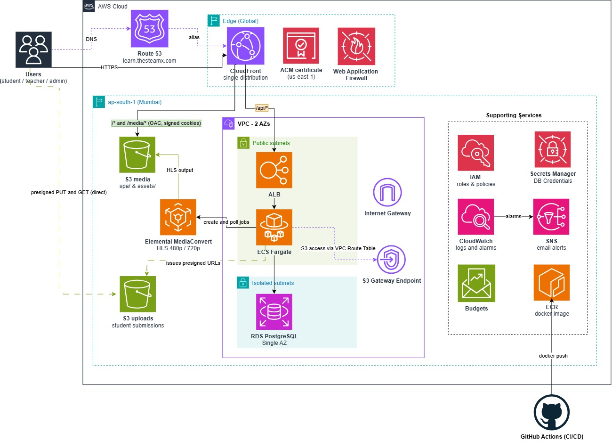

# Production AWS Architecture

This page describes a proposed production deployment, not resources currently deployed by CDK.
Use [infrastructure operations](../operations/infrastructure.md) for the current stack.

## Overview and scale assumptions

| Item                  | Target                                          |
| --------------------- | ----------------------------------------------- |
| Region                | `ap-south-1`                                    |
| Initial scale         | 2–3 schools; about 2k students in year 1        |
| Downtime tolerance    | A few hours off-hours                           |
| Database availability | Single-AZ; no Multi-AZ                          |
| Application host      | `learn.thesteamx.com`                           |
| Origin host           | `origin.thesteamx.com`, used only by CloudFront |
| Browser origins       | One host; no app/API CORS and no subdomains     |

The current CDK stack is limited to S3, an IAM user, and a budget. Database backup, restore, ECS,
and ALB operations described here are not implemented in the repository.

## Diagram

## Request routing

| Request    | CloudFront behavior / origin  | Access and handling                                                                                                                          |
| ---------- | ----------------------------- | -------------------------------------------------------------------------------------------------------------------------------------------- |
| `/api/*`   | ALB                           | Caching off; forward cookies and authorization headers, not `Host`. Add secret `X-Origin-Verify`; ALB rejects requests without it.           |
| `/media/*` | `media` S3 bucket through OAC | Signed cookies required, scoped to cookie path `/media/`. Viewer-request function strips `/media` before resolving the `assets/` object key. |
| Default    | `media` S3 bucket through OAC | Maps to `spa/`. Default-behavior function rewrites extension-less paths to `/index.html` for SPA navigation.                                 |

Use one CloudFront distribution on the flat-rate Pro plan: $15/month, 10M requests, with bundled
WAF, DDoS protection, and DNS and no overage. Do not configure distribution-level custom error
responses; they could turn API or media errors into `index.html`.

Use an ACM certificate in `us-east-1` for CloudFront and a separate ACM certificate in
`ap-south-1` for the ALB origin.

## Network and security-group chain

- One VPC across two AZs, with an Internet Gateway and no NAT.
- Two public subnets: ALB and Fargate tasks. Tasks receive public IPs for outbound-only access.
- Two isolated subnets with no internet route: RDS subnet group spans both AZs; the single RDS
  instance runs in one AZ.
- S3 gateway endpoint for private-subnet access to S3.
- Security-group chain: ALB accepts HTTPS only from the CloudFront origin-facing prefix list
  (may require an SG rule quota increase) → tasks accept traffic only from the ALB SG → RDS accepts
  PostgreSQL port `5432` only from the task SG.

## Compute

- Public HTTPS ALB health check: `GET /health/live`.
- ECS Fargate service `api`: NestJS, ARM64, 0.5 vCPU and 1 GB.
- Autoscaling: minimum 1 and maximum 2 tasks, targeting about 60% CPU.
- Rolling deployment: minimum healthy 100%, maximum 200%; deployment circuit breaker with rollback.
- Private ECR repository. Build the image for `linux/arm64` on Debian slim, not Alpine.
- Run `prisma migrate deploy` as a one-off ECS task in CI before the ECS rolling update.
- Migrations must remain backward-compatible with the previous app version: expand first, then
  contract in a later release while old and new tasks can overlap.
- In-process storage cleanup and MediaConvert polling use `FOR UPDATE SKIP LOCKED`.
- Set NestJS trusted proxy hops to 2 (CloudFront → ALB → task). Use ECS Exec for database debugging;
  no bastion.

## Database

- RDS PostgreSQL, `db.t4g.small`, single-AZ, encrypted, and private.
- gp3 storage with storage autoscaling; 14-day automated backups with PITR; deletion protection;
  removal policy `RETAIN`.
- Take a snapshot before each migration deploy. Schedule maintenance off-hours IST.
- Prisma connection pool: about 10 connections per task. No RDS Proxy.

## Storage

Both buckets are private, block public access, encrypted, and versioned. Expire noncurrent versions
after 30 days; do not expire current objects.

| Bucket    | Contents and access                                                                                                                                                                    |
| --------- | -------------------------------------------------------------------------------------------------------------------------------------------------------------------------------------- |
| `media`   | `spa/` frontend build and `assets/` uploads/HLS output. Served through CloudFront OAC. Keys use `assets/<assetId>/<fileId>/...`; HLS output is under `assets/<assetId>/<fileId>/hls/`. |
| `uploads` | Student submission files; not behind CloudFront. API-issued presigned URLs only.                                                                                                       |

Both buckets allow browser `PUT` CORS requests from `https://learn.thesteamx.com`. The task role
may write only to `media/assets/` and the `uploads` bucket; the frontend deploy role may write only
to `media/spa/`.

**Retention:** Purged data can remain in S3 noncurrent versions for up to 30 days and in RDS backups
for up to 14 days.

## Video pipeline and playback

- Admin uploads the original video with a presigned S3 `PUT`.
- The API creates a MediaConvert job for HLS at 480p and 720p, using 6-second segments.
- The scheduler polls job status and marks the asset `READY`.
- For playback, the API checks authentication, school subscription, and lesson release, then issues
  CloudFront signed cookies scoped only to that file's `hls/` prefix, never the original upload.
- Signed cookies have a short 1–2 hour TTL and are re-issued when the viewer switches videos.
  Revocation takes effect when the cookie expires, so keep the TTL short.
- The original upload is never reachable through CloudFront.
- PPTX is download-only through a presigned URL. Image and PDF delivery is TBD; see
  [Open items](#open-items).

## Config and secrets

- Secrets Manager only: database credentials, JWT secret, CloudFront signing private key, and
  origin-verify header value. No SSM.
- Non-secret configuration is set as plain environment variables in CDK.
- Session cookie: `httpOnly`, `Secure`, `SameSite=Lax`, host-only.

## Monitoring and alarms

- CloudWatch Logs retention: 30 days. Do not log health checks.
- Seven CloudWatch alarms publish to one SNS email topic: ALB 5xx, unhealthy ALB hosts, ECS running
  tasks below 1, RDS CPU, RDS free storage, RDS connections, and CloudFront requests at about 70%
  of the request cap.
- Also use an AWS Budget alert, Sentry free tier, and an external uptime check on `/health/ready`.
- Add throttling for login and reset-password in the production-hardening milestone.

## CI/CD

- Infrastructure is AWS CDK (TypeScript) in `/infra`.
- GitHub Actions assumes AWS roles using OIDC; no static keys.
- Backend: test → build ARM64 image → push to ECR → RDS snapshot → migration task → ECS rolling
  update.
- Frontend: build → sync to `media/spa/` → CloudFront invalidation.

## Constraints and conventions

- Keep the app and API on `learn.thesteamx.com`; `origin.thesteamx.com` is only for CloudFront's
  ALB origin. Do not forward the viewer `Host` header to the API.
- Require the CloudFront origin-verify header at the ALB and restrict its security group to the
  CloudFront origin-facing prefix list.
- Keep S3 private and use OAC for CloudFront origins. Never expose the original video.
- Keep task, frontend-deploy, and storage permissions scoped to their required bucket/prefixes.
- Keep schema changes compatible across overlapping ECS versions; serialize scheduler work with
  `FOR UPDATE SKIP LOCKED`.

## Known tradeoffs

- Single-AZ RDS reduces availability; recovery can take up to the tolerated off-hours window.
- Public Fargate tasks avoid NAT, but depend on tightly scoped security groups and outbound-only
  task access.
- Signed-cookie access cannot be revoked immediately; expiry bounds the access window.
- Without RDS Proxy, database connections scale with the task count and pool size.
- In-process schedulers run on more than one task; database row locking coordinates their work.

## Open items

- How are images and PDFs served: signed cookies or presigned S3 URLs?
- Verify the CloudFront Pro plan supports key groups/signed cookies, multiple origins, OAC and CloudFront Functions, and what happens when the 10M request cap is exceeded.
- MediaConvert cost per minute and processing time (to be measured in the video spike).
